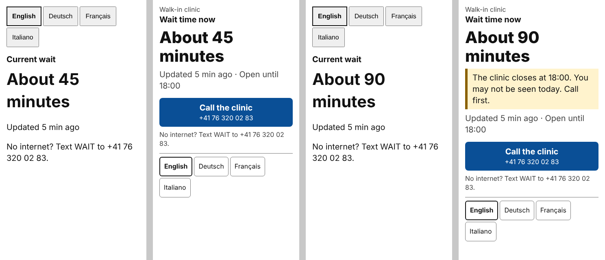
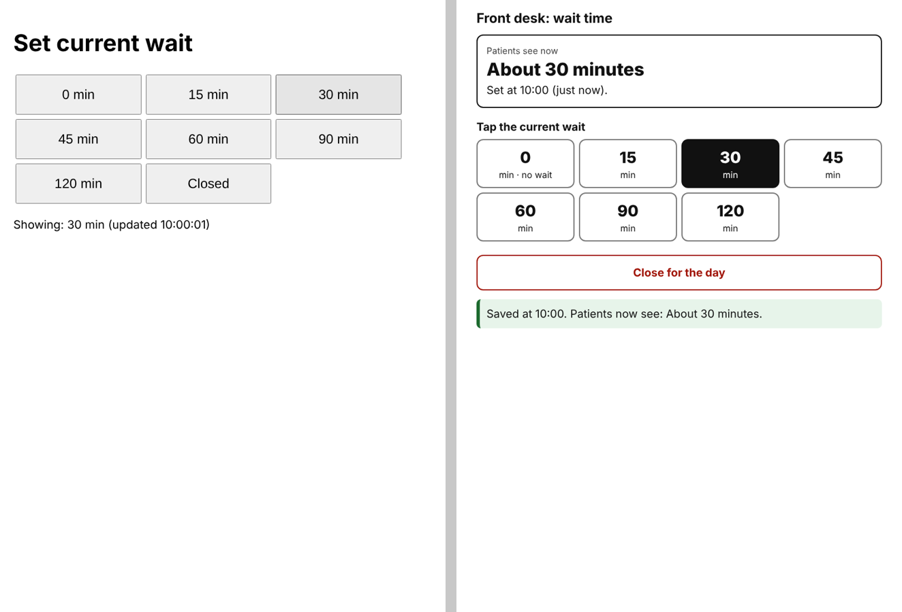
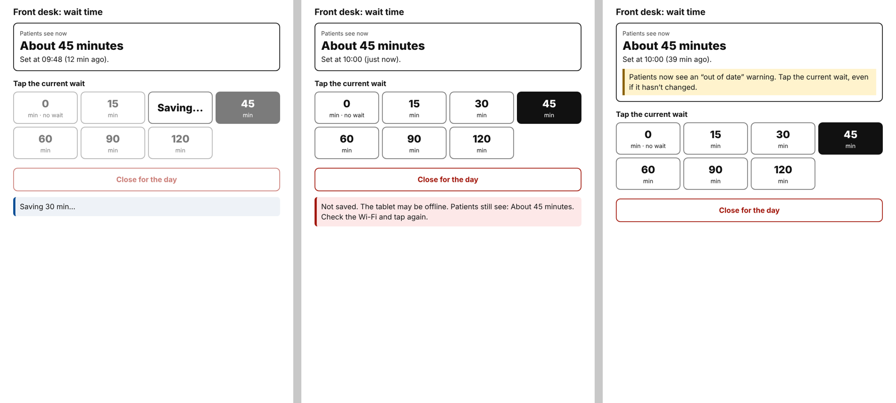

# Clinic wait time, Part 3: critique and accessibility audit

**What was compared:** v1, which AI built from the technical spec (Parts 1–2), and v2, which AI rebuilt against [DESIGN.md](DESIGN.md). Both were run through the same audit script in headless Chromium:

- Phone viewport 360 × 640, staff tablet 800 × 1100.
- Clinic time zone Europe/Zurich, reference day Tuesday 3 Nov 2026.
- The server mocked: the patient page's status request and the staff page's `google.script.run` calls.







## 1. Scores against the four criteria

| Criterion | v1 | v2 | Main evidence |
|---|---|---|---|
| **Clarity and mental model** | Partly | Yes | v1's staff page said "Showing: 30 min (updated 10:00:01)": a status read-out with seconds. v2 says "Patients see now: About 30 minutes. Set at 10:00 (just now)." That is the question a receptionist actually asks. |
| **Information hierarchy** | No | Yes | In v1 the first four things on the patient page were the language buttons; the answer came fifth. In v2 the answer is first after the clinic name, the warning sits right under it, and every state ends with a Call button. |
| **Accessibility** | Passed axe; failed the manual checks | Passes both | axe found only landmark warnings in v1. The manual checks found unchanged polls re-announced every minute, no visible focus style, no pressed state on staff buttons, and no page title on the staff page. |
| **Feedback and error handling** | No | Yes | v1: no "saving" state, a double tap sent two saves, and the failure message "Not saved. Try again." stayed on screen 40 minutes later. v2: the tapped button shows "Saving…" and the others are disabled, one save per double tap, and a failure says what patients still see and what to do. |

## 2. Where AI did well

- **Logic and edge cases.** All the rules sit in `status.js` with 14 unit tests: zero wait, out-of-date warning, closed, no data, clock skew, and the closing-time warning. Each one held in every language. The web page, texts and calls all use the same function, so they can't disagree.
- **Performance.** The page plus script is 12.7 KB, starts the status request before the script has loaded, and needs no build step.
- **Baseline accessibility in v1.** Contrast, the `lang` attribute, 48 px touch targets, no sideways scroll at 200% zoom, and the correct `lang` on each language button. AI got these right without being reminded.
- **Rebuilding against a written spec.** Once DESIGN.md set out each state, the copy and the interaction rules, the rebuild followed it closely. The order on screen, the copy table and the live-region rules all came out as written.

## 3. Technically correct, but flat

These all passed the v1 acceptance tests, yet feel wrong to use.

| # | v1 behaviour | Why it feels wrong | v2 |
|---|---|---|---|
| 1 | "About 90 minutes" at 17:15, when the clinic closes at 18:00 | Correct number, misleading answer: the patient drives over and isn't seen. | Warning under the answer: "The clinic closes at 18:00. You may not be seen today. Call first." |
| 2 | "Opens Wednesday at 8 AM" on Tuesday evening | Nobody calls tomorrow by its weekday name. "8 AM" is also foreign in Switzerland. | "Opens tomorrow at 8:00" |
| 3 | "Updated 0 min ago" | Reads like a fault. | "Updated just now" |
| 4 | Loading shows "…" | Looks frozen, and a screen reader reads out "dot dot dot". | "Checking the wait time…" in the page's language |
| 5 | The phone number appeared only in the no-data state | Every state has a reason to call: stale, closing soon, long wait. | Full-width **Call the clinic** button in every state |
| 6 | No clinic name | People can't tell they're on the right clinic's page. | Clinic name above the answer |
| 7 | One failed refresh wipes the answer to "not available" | Weak parking-lot signal makes a good answer vanish. | Keeps the last answer; its age keeps counting, so the out-of-date warning still appears |
| 8 | Staff page: no sign of which value is live | Staff must read small text to know the state. | Current value is a filled button, announced as "pressed" |
| 9 | Staff page: "Closed" looks like the other buttons, in the same grid | Easy to close the clinic by mistake. | "Close for the day" is set apart, red-outlined and full width |
| 10 | Staff page: nothing reminds anyone to update | The estimate quietly goes stale. | After 30 minutes: "Patients now see an 'out of date' warning. Tap the current wait, even if it hasn't changed." |
| 11 | Outside opening hours, a tap seems to do nothing | Staff tap again and again. | Explains that patients see "closed" whatever is tapped |
| 12 | Wrong staff link: "Not authorized." | No reason given, and no one named to fix it. | Says the PIN changes monthly and to ask the clinic manager |

### What is still flat in v2

- **The answer is a number, not a judgement.** "About 45 minutes" doesn't say whether that's normal for this clinic or getting better. Showing a trend would mean keeping a history of waits. Part 2 ruled that out for privacy, so this is a deliberate limit, not an oversight.
- **The staff page is English only, and so is its preview.** Staff at a Swiss desk can't check the German or French sentence patients see. A language switch, or a preview in all four languages, is the next step.
- **Reminders only work if someone looks.** The out-of-date nudge is on screen but makes no sound. A chime or a screen flash when the estimate goes stale would make it noticeable. That needs testing at a real desk.
- **The "No internet? Text WAIT to …" line is shown to someone who is online.** It's there for people to screenshot or pass on, but it reads oddly. A short "Save this number" label might work better.
- **It looks like a plain form.** System font, no logo, no colour except the button and the warnings. That's deliberate for the 30 KB limit and for trust, but it doesn't look like it belongs to the clinic. The real clinic name (currently the placeholder "Walk-in clinic") and the clinic's colour would help.
- **Language buttons wrap unevenly.** At 360 px, "Italiano" sits alone on a second row.

## 4. Accessibility audit

### Method

| Check | Tool | Standard |
|---|---|---|
| Automated rules | axe-core 4.10, tags wcag2a/aa and wcag21a/aa, plus best-practice | WCAG 2.1 AA |
| Colour contrast | axe, plus each colour pair in the palette calculated by hand (including non-text contrast) | 1.4.3, 1.4.11 |
| Keyboard | Tab through each page; record the order and the focus style; save using the keyboard | 2.1.1, 2.4.3, 2.4.7 |
| Screen reader | Read the accessibility tree; count live-region announcements over three unchanged polls; check where focus lands after an action | 4.1.2, 4.1.3 |
| Zoom and reflow | 360 px and 180 px (200% zoom), all 4 languages × 5 states | 1.4.4, 1.4.10 |
| Targets | Every link and button at least 48 × 48 px | 2.5.5 (AAA, required by our spec) |

### Results

| Check | v1 | v2 |
|---|---|---|
| axe, patient page (all states) | 2 best-practice issues: no `<main>`, content outside landmarks | 0 |
| axe, staff page | 1 serious (no `<title>`), 2 best-practice | 0 |
| axe, 4 languages × 5 states × 2 widths | (not run in this form) | 40 / 40 pass |
| Contrast | Pass (lowest pair: warning edge 3.10:1, a near miss) | Pass. Lowest pair 4.54:1 (button border, needs 3:1); warning edge raised to 5.00:1 |
| Focus visible | Browser default 1 px ring only | 3 px ring (4 px on staff), 8.17:1 against white |
| Tab order matches visual order | Language buttons first, before the answer | Call button, then languages; staff: waits, then Close |
| Unchanged poll re-announced | **3 times in 3 minutes** | 0 |
| Staff current value exposed to assistive tech | No | `aria-pressed="true"` |
| Staff save result announced | Same `role=status` line, no pending state | "Saving…" (status), "Saved…" (status), failure (alert) |
| Focus after a keyboard save | n/a (buttons never disabled) | **Lost to the page body** in the first rebuild; fixed: returns to the pressed button |
| Accessible name of staff buttons | "30 min" | **"30min"** in the first rebuild (missing space); fixed |
| Reflow at 200% zoom | Pass | Pass |
| One screen at 360 × 640, no scrolling | Pass | Pass in all 4 languages and 5 states |

### What AI missed

**In v1, missed by AI and passed by axe.** Every item below was found by the manual checks, not by automated rules.

1. Live regions re-announced the same answer on every 60-second poll. Screen-reader users would hear "About 45 minutes" once a minute, for as long as the page is open.
2. The browser's default focus ring is the only focus style, and it is thin against the grey buttons.
3. The staff page doesn't expose which wait is current, so a blind receptionist can't tell what patients see without hunting for a status line.
4. A double tap sent two saves, and there was no pending state.
5. The staff error message never expires.
6. The staff page has no `<title>` (axe did catch this one).
7. The language buttons come before the answer, for screen readers and keyboard users as well as on screen.

**In the first v2 pass, missed by AI again and caught by the audit.** These show that rebuilding against a spec doesn't make the result correct on its own. Each was found only because the audit tested the behaviour, not the markup.

1. **Button names "15min" and "0min · no wait".** The number and the small "min" label were joined with no space. A screen reader reads "fifteen-min". Fixed.
2. **Keyboard focus lost after every save.** Disabling the buttons during a save dropped focus to the page body, so a screen-reader user was sent back to the top after each tap. Fixed: focus returns to the button that was pressed.
3. **"Saving…" styled green, like "Saved".** At a glance, a pending save looked finished. Fixed: the pending state uses a neutral blue-grey.
4. **The failure alert stayed on screen for 40 minutes.** This was the same flaw as v1, rebuilt from a spec that never said how long a message should stay up. Fixed: save results clear after 5 minutes, and the card above shows the current state.

### Not yet tested (needs people and devices)

- Real screen readers: VoiceOver on iPhone, TalkBack on Android, and NVDA if staff use Windows. The accessibility tree and live-region counts are a stand-in for listening to them.
- Windows High Contrast and other forced-colours modes, especially the filled "pressed" staff button.
- A five-minute usability test at the front desk with two receptionists, and with three or four patients in the parking lot, on their own phones and mobile data.
- A native speaker's read of the German, French and Italian copy, including the new closing-time and loading messages.

## 5. How to rerun

```bash
node --test status.test.js
```

The browser audit scripts (audit, matrix, focus) are in the session scratchpad. They can be added to the repo as a `tests/` folder if they should run in CI.
